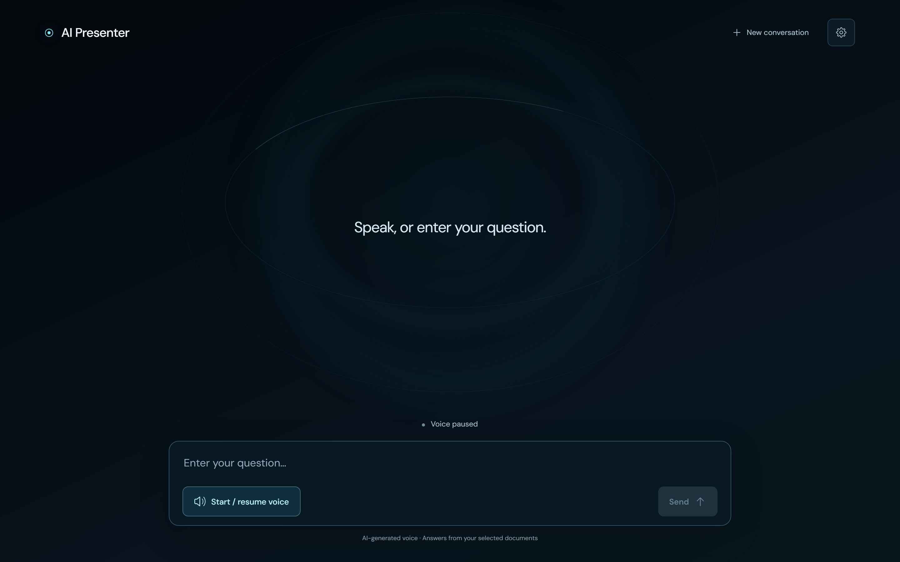
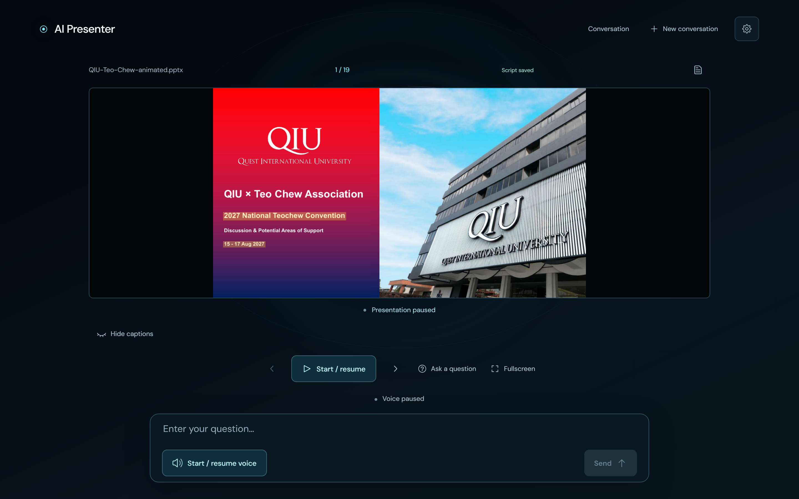
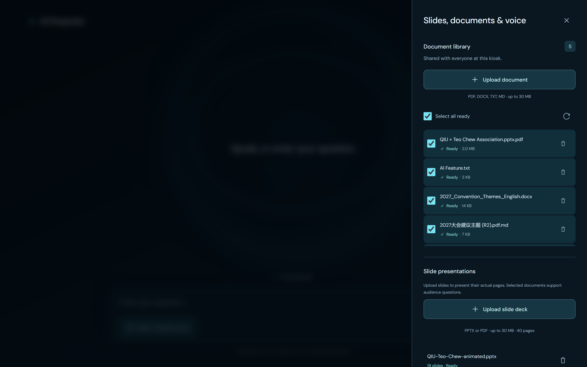
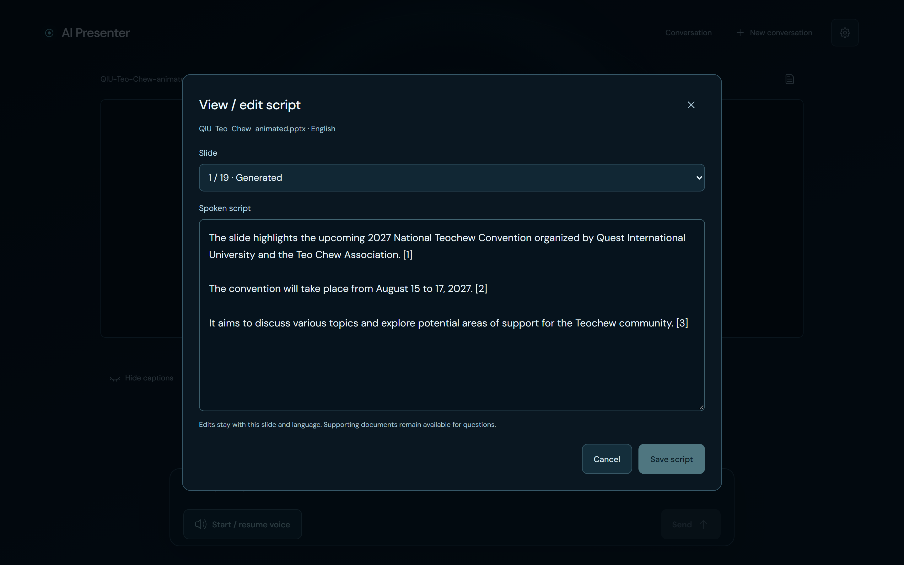
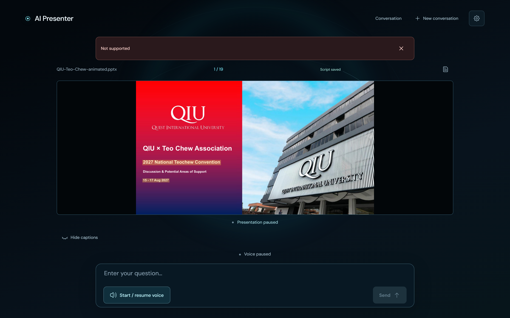
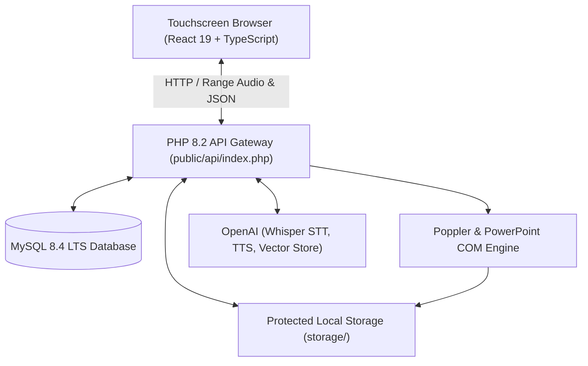
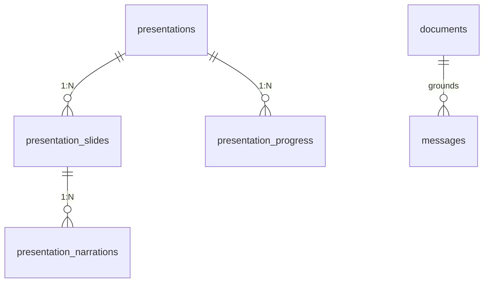

# AI Presenter — Document-Grounded Chat & Presentation Kiosk

[](https://www.typescriptlang.org/)
[](https://react.dev/)
[](https://www.php.net/)
[](https://www.mysql.com/)
[](https://platform.openai.com/)

**AI Presenter** is a touchscreen kiosk application and autonomous slide presenter designed for zero-login public environments. Visitors upload reference documents or slide decks, speak or type questions, view synchronized slide media and live captions, and hear high-fidelity synthesized speech. 

All answers and generated narration are grounded in uploaded evidence with verifiable citation checking. Unsupported questions receive an explicit, polite refusal.

---

## Visual Showcase

The interface was captured live via Playwright browser automation (`scripts/take-screenshots.mjs`):

| Main Kiosk Conversational View | Slide Presentation Mode |
|:---:|:---:|
|  |  |

| Document & Presentation Settings | Verbatim Script Editor |
|:---:|:---:|
|  |  |

| Question Breaks & Voice Preferences | Interactive Floor Q&A Overlay |
|:---:|:---:|
|  |  |

---

## Documentation Index

Comprehensive engineering, technical, and operational documentation is available in the [`docs/`](docs/) directory:

- 🏛️ **[Software Architecture (`docs/ARCHITECTURE.md`)](docs/ARCHITECTURE.md)**: System topology, client-server C4 diagrams, state machines, audio streaming pipeline, PowerPoint COM conversion, and security isolation.
- 📋 **[System Specification (`docs/SPEC.md`)](docs/SPEC.md)**: Complete functional requirements, non-functional bounds, complete API routes & schema contracts, and operational SLAs.
- 🗄️ **[Database Schema & ERD (`docs/DATABASE.md`)](docs/DATABASE.md)**: Entity-Relationship diagram, table definitions, foreign key cascade constraints, indexing strategies, and disaster recovery procedures.
- 📖 **[User Guide & Operator Manual (`docs/USER_GUIDE.md`)](docs/USER_GUIDE.md)**: Visitor walk-throughs, presenter guides, script editing instructions, question break setup, and troubleshooting FAQs.
- 🎨 **[Design System (`DESIGN.md`)](DESIGN.md)**: Color tokens, DM Sans typography, Sci-Fi aura composition, and touch target accessibility.
- 🔍 **[Verification Report (`VERIFICATION.md`)](VERIFICATION.md)**: Complete validation logs, test passes, and local runtime verification records.

---

## Key Capabilities

1. **Hands-Free Continuous Voice Loop**:
   - Voice activity detection with local audio-level gating.
   - Automatically submits queries after **1.2s of detected silence** (max 60s recordings).
   - Automatically silences the microphone while the AI is transcribing, generating, and speaking to eliminate audio feedback.
2. **Autonomous Slide Presentations**:
   - Accepts PowerPoint (`.pptx`) and PDF files (up to 30 MB, 40 slides).
   - High-definition uncropped slide rendering (1920x1080).
   - Native PowerPoint COM animation export into synchronized per-slide MP4 video clips.
   - Native embedded slide video playback with full audio.
3. **Verbatim Script Editing**:
   - Generates narration scripts upfront in **English** or **Chinese**.
   - Built-in script editor allows operators to edit narration text up to 12,000 characters per slide.
   - Saves scripts verbatim with cryptographic revision hashing (`409 Conflict` guards).
4. **Customizable Audience Question Breaks**:
   - Configure which slides pause for audience questions (`None`, `Last slide`, `All slides`, or custom selections).
   - Configurable question interval (5–30 seconds) with speech detection hold.
5. **Strict Grounding & Citation Proof**:
   - Queries are grounded in OpenAI Vector Store indices and slide evidence.
   - Dual-stage verification checks that citations exist in the source document before displaying an answer.
   - Unsupported queries receive an honest refusal.

---

## Architecture Overview



---

## Database Schema Summary

The database uses MySQL 8.4 LTS InnoDB with 8 relational tables:



- **`documents`**: Metadata, file sizes, storage paths, and OpenAI Vector Store file IDs.
- **`messages`**: Anonymous visitor chat history, role, speech segment boundaries, and citation JSON.
- **`presentations`**: Slide deck catalog, status, page count, and storage keys.
- **`presentation_slides`**: Rendered slide PNG paths, extracted text, and conversion methods.
- **`presentation_narrations`**: Cached or manually edited narration scripts per slide and language.
- **`presentation_progress`**: Visitor presentation playback position and state.
- **`settings`**: Persistent system settings and key-value pairs.
- **`rate_limits`**: Token-bucket client IP rate-limiting records.

*(See [`docs/DATABASE.md`](docs/DATABASE.md) for full SQL definitions and data dictionaries).*

---

## Local Setup & Quickstart

### Prerequisites
- **Node.js**: v20+ / v22+ and npm.
- **PHP**: 8.2+ with `curl`, `pdo_mysql`, `mbstring`, `fileinfo`, and `zip`.
- **MySQL**: 8.0+ or 8.4 LTS.
- **Poppler Utilities**: `pdftoppm`, `pdfinfo`, `pdftotext` (configured in PATH or `POPPLER_BIN`).
- **PowerPoint**: Installed Microsoft PowerPoint for native PPTX animation/video export (`POWERPOINT_CONVERSION=true`).
- **Operating System**: Windows 10/11 or Windows Server.

### Port Allocations
The workstation harness reserves:
- `docchat/web` on port **3250**
- `docchat/mysql` on port **3251**

### Installation
From the project root:

```powershell
# 1. Install dependencies & build static client
npm ci
npm run build

# 2. Run local setup (initializes storage, database, CA certificates)
powershell -NoProfile -ExecutionPolicy Bypass -File scripts/setup-local.ps1

# 3. Configure OpenAI API Key
powershell -NoProfile -ExecutionPolicy Bypass -File scripts/set-openai-key.ps1

# 4. Launch the application
webapp docchat
# Or launch directly with PowerShell:
powershell -ExecutionPolicy Bypass -File start.ps1
```

Open `http://127.0.0.1:3250` in any modern web browser.

---

## Capturing UI Screenshots with Playwright

To re-capture all UI screenshots automatically into `docs/screenshots/`:

```powershell
node scripts/take-screenshots.mjs
```

The script runs a headless Chromium browser through Playwright, visits all major screens and modals (kiosk chat, settings drawer, presentation stage, script editor, Q&A overlay, mobile viewport), and saves retina 2x PNG assets.

---

## Backup & Disaster Recovery

### Creating a Snapshot
Stop the web server (`Ctrl+C`), leaving MySQL running, then execute:

```powershell
powershell -NoProfile -ExecutionPolicy Bypass -File scripts/backup.ps1
```

The backup snapshot is saved in `storage/backups/<UTC-TIMESTAMP>/` containing:
- `database.sql`: Full transactional MySQL dump.
- `database-check.json`: Relational validation and row-count inventory.
- `manifest.json`: SHA-256 integrity checksums for all files.
- Uploaded source documents, rendered slide images, and MP4 media.

### Recovery Drill
1. Validate files against `manifest.json`.
2. Provision an empty MySQL database.
3. Import `database.sql` with `mysql --defaults-extra-file=...`.
4. Restore `storage/uploads/` and `storage/presentations/`.
5. Run `php scripts/database-inventory.php` to verify all 8 tables and row counts.

---

## Operational Security & Hosting Guidelines

1. **Document Root**: Only `public/` may be exposed as the web server document root. Keep `backend/`, `.env`, `storage/`, and `database/` private.
2. **Access Control**: Application database credentials require `SELECT, INSERT, UPDATE, DELETE` permissions only.
3. **Session Reset**: The physical kiosk resets automatically after 15 minutes of idle time, or immediately when the visitor taps `New conversation`.
4. **Certificate Trust**: Project-local CA bundles are exported to `storage/windows-ca.pem` to prevent cURL error 60 with enterprise inspection proxies while maintaining strict peer verification.

---

## License

Private and proprietary. All rights reserved.
