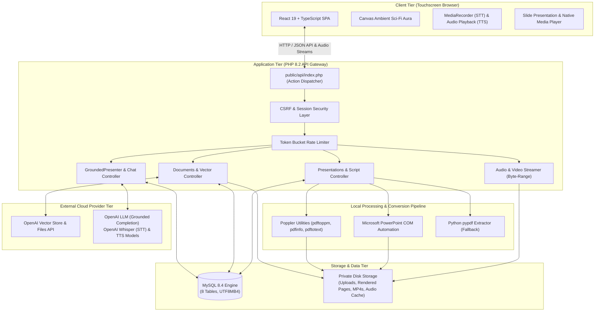
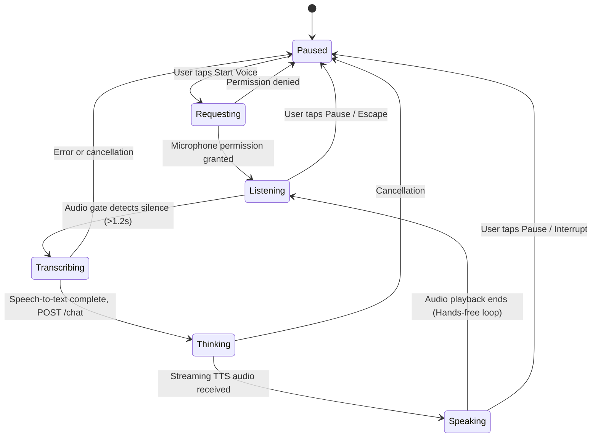
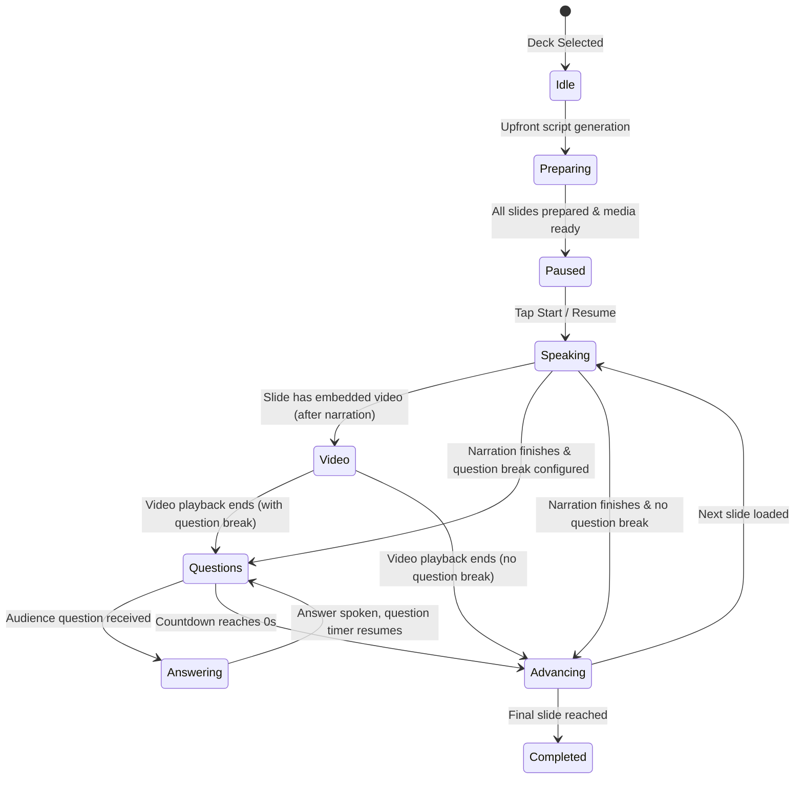
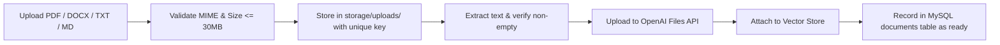
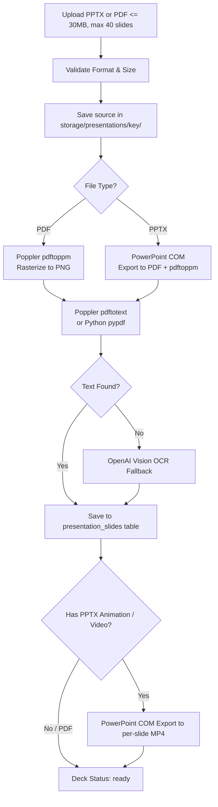
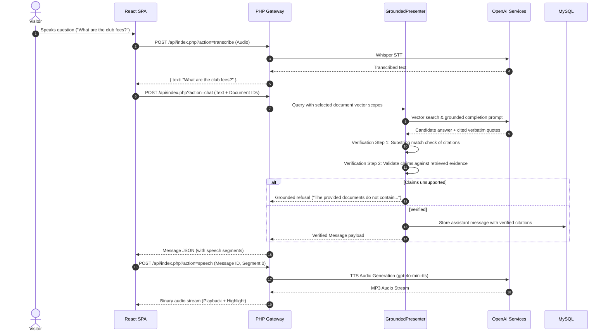

# AI Presenter — Software Architecture

## 1. System Overview

**AI Presenter** is an autonomous, touchscreen-ready kiosk application and presentation engine designed for zero-login public environments. It enables visitors and operators to upload documents and slide decks, interact hands-free via continuous voice or text, hear synthesized AI narration and answers, view authentic slide media, and inspect cited source evidence.

The architecture emphasizes strict factual grounding (refusing invented claims), deterministic caching, resilient local multi-process execution, and clear separation between static presentation assets and protected backend services.

---

## 2. Frontend Architecture

The frontend is implemented in **React 19** with **TypeScript** and bundled via **Vite** into static production assets. It is optimized for responsiveness, physical touch targets (minimum 44–48px), hardware-accelerated animations, and instant keyboard/focus navigation.

### Component Structure
- `App.tsx`: Main kiosk shell, anonymous session bootstrapper, layout orchestration, topbar actions, conversation transcript, and bottom composer.
- `PresentationStage.tsx`: Cinematic slide presentation viewport. Manages uncropped slide artwork, synchronization with HTML5 muted animation videos or audible embedded videos, caption subtitle lines, and interactive floor-question overlays.
- `ScriptEditor.tsx`: Modal interface for inspecting, editing, and saving verbatim per-slide narration scripts with optimistic concurrency controls.
- `useContinuousVoice.ts`: Microphone state machine implementing voice-activity gating, silence detection (~1.2s timeout), recording buffer management, and automatic turn orchestration.
- `useSpeechPlayback.tsx`: Audio playback coordinator. Handles segment-by-segment MP3 audio streaming, prefetching upcoming segments, and precise audio time-update synchronization for visual text highlighting.
- `usePresentation.ts`: Presentation state manager coordinating slide transitions, question policy evaluations, prefetching, and audience interaction cycles.
- `useConversationScroll.ts`: Reading position tracker that respects manual visitor scrolling during active assistant replies.

### Frontend State Machines

#### Continuous Voice State Machine

#### Slide Presentation State Machine

### Ambient Energy Field (Aura)
The background features a non-intrusive science-fiction aura with orbiting cyan rings and energy fields (`.ambient-field`). It reflects real operational states:
- **Idle / Paused**: Slow, quiet baseline pulse.
- **Listening**: Expanded cyan focus tracking user voice activity.
- **Thinking**: Concentrated breathing glow during LLM and vector processing.
- **Speaking**: Radiant orbital movement synchronized with audio playback.
- **Accessibility**: Automatically converts to a static non-animated gradient when `prefers-reduced-motion` is detected.

---

## 3. Backend Architecture

The backend is built as a hardened, lightweight PHP 8.2 service without heavy external framework bloat. It exposes a single entry gateway at `public/api/index.php`.

### Gateway Architecture
- **Router & Action Dispatcher**: Validates HTTP verbs and routes requests via `?action=<name>` to modular controller classes.
- **Security & CSRF Protection**:
  * Every mutation (POST) requires a valid `X-CSRF-Token` header matching the anonymous visitor session.
  * Tokens rotate upon creating a new session (`action=new-session`).
  * Cross-origin requests from foreign referrers/origins are strictly rejected.
- **Input Validation & Sanitization**:
  * Strict file MIME verification (PDF, DOCX, TXT, MD, PPTX, WebM, MP4, MP3, WAV).
  * Payload size bounds: 30 MB for documents and slides, 10 MB for voice audio.
  * Path traversal protection: Assets are stored with SHA-based unique keys outside the public root.
- **Rate Limiting**:
  * Database-backed token-bucket rate limiter (`rate_limits` table) enforcing IP and session request thresholds.

### Core Backend Modules
1. `bootstrap.php`: Environment initialization, database PDO singleton creation, error handler configuration, and directory validation.
2. `Documents.php`: Document upload handling, text extraction, local storage, OpenAI Vector Store synchronization, and lifecycle management.
3. `Presentations.php`: Slide deck management, page extraction, narration script retrieval, manual script revisions, and question break policy storage.
4. `SlideConverter.php`: Integration with native Poppler utilities for rasterizing slides to 1920x1080 PNG images and extracting text.
5. `AnimationConverter.php`: Microsoft PowerPoint COM automation interface for exporting slide animations to MP4 and isolating embedded slide videos.
6. `GroundedPresenter.php`: Dual-stage RAG verification engine. Verifies quotes against source text and validates each proposition before presenting an answer.
7. `OpenAI.php`: Client interface for OpenAI Assistants, Vector Store, Files API, Whisper STT, and TTS audio synthesis.
8. `Chat.php`: Visitor conversation session management, message persistence, and citation tracking.
9. `Audio.php`: High-performance binary streaming with support for HTTP `Range` requests (`206 Partial Content`) for video and audio playback.

---

## 4. Ingestion & Conversion Pipelines

### Document Ingestion Pipeline

### Presentation & Slide Media Ingestion Pipeline

---

## 5. Grounding, RAG & Verification Architecture

To eliminate AI hallucinations in public environments, AI Presenter enforces strict factual grounding:

### Verbatim Script Editing Safety
When an operator edits a presentation script via `ScriptEditor`:
1. The script is stored verbatim in `presentation_narrations` with `source='manual'`.
2. A cryptographic revision hash prevents concurrent edits from overwriting each other (`409 Conflict`).
3. Automated script preparation routines will **never overwrite** manually edited scripts.
4. During presentation delivery, manual scripts are read verbatim by the TTS engine without calling the LLM.

---

## 6. Security & Isolation Architecture

1. **Zero Visitor Authentication & Clean Session Boundaries**:
   - Designed for unattended kiosks.
   - Conversations are isolated using browser-scoped session identifiers stored in local storage and HTTP headers.
   - Session resets (`New conversation` or 15 minutes of inactivity) purge conversation data for that terminal without affecting shared documents.
2. **Filesystem Isolation**:
   - Only `public/` is accessible via the web server.
   - `backend/`, `.env`, `storage/`, and `database/` reside strictly outside the document root.
   - Direct HTTP access to private uploaded files or rendered slide images is prevented; all media is served through authenticated API endpoints enforcing session checks.
3. **Restricted Windows Permissions**:
   - Sensitive local configuration (`.env`, `storage/local-settings.json`, and database credentials) is locked via Windows ACLs to the current operating user and `SYSTEM` only (`icacls`).
4. **Subprocess Isolation**:
   - PPTX conversion and Poppler tools run with bounded timeouts and execution guards to prevent denial-of-service or hanging processes.
