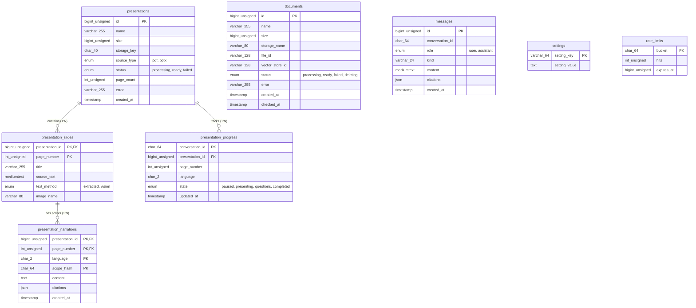

# AI Presenter — Database Schema & Data Dictionary

## 1. Overview & Engine Specification

The persistence layer uses **MySQL 8.4 LTS** (compatible with MySQL 8.0+) configured with the `InnoDB` storage engine and `utf8mb4_unicode_ci` collation. 

- **Database Name**: `docchat`
- **Default Charset**: `utf8mb4`
- **Default Collation**: `utf8mb4_unicode_ci` (or `utf8mb4_0900_ai_ci`)
- **Isolation & Concurrency**: Strict relational constraints with `FOREIGN KEY ... ON DELETE CASCADE` on child presentation records.
- **Access Control**: Scoped application account (`docchat`@`127.0.0.1`) restricted strictly to `SELECT, INSERT, UPDATE, DELETE`. Administrative privileges (`CREATE, DROP, ALTER, GRANT`) are reserved for migration scripts.

---

## 2. Entity-Relationship Diagram (ERD)



---

## 3. Detailed Table Definitions

### 3.1 `documents`
Stores metadata and indexing status for uploaded PDF, DOCX, TXT, and Markdown files.

| Column | Type | Nullable | Default | Description |
|:---|:---|:---:|:---|:---|
| `id` | `BIGINT UNSIGNED` | No | `AUTO_INCREMENT` | Primary key |
| `name` | `VARCHAR(255)` | No | — | Original uploaded file name |
| `size` | `BIGINT UNSIGNED` | No | — | File size in bytes (max 31,457,280 bytes) |
| `storage_name` | `VARCHAR(80)` | No | — | Internal unique file path key under `storage/` |
| `file_id` | `VARCHAR(128)` | Yes | `NULL` | OpenAI File ID for retrieval |
| `vector_store_id`| `VARCHAR(128)` | Yes | `NULL` | OpenAI Vector Store ID housing the embeddings |
| `status` | `ENUM(...)` | No | `'processing'` | `'processing'`, `'ready'`, `'failed'`, `'deleting'` |
| `error` | `VARCHAR(255)` | Yes | `NULL` | Diagnostic error message if indexing failed |
| `created_at` | `TIMESTAMP` | No | `CURRENT_TIMESTAMP` | Record creation timestamp |
| `checked_at` | `TIMESTAMP` | Yes | `NULL` | Timestamp of last health check |

**Indices**:
- `PRIMARY KEY (id)`
- `INDEX documents_status (status)`

---

### 3.2 `messages`
Persists the conversation history between visitors and the AI Presenter.

| Column | Type | Nullable | Default | Description |
|:---|:---|:---:|:---|:---|
| `id` | `BIGINT UNSIGNED` | No | `AUTO_INCREMENT` | Primary key |
| `conversation_id`| `CHAR(64)` | No | — | Anonymous session hash scoped to the visitor |
| `role` | `ENUM('user','assistant')` | No | — | Participant role |
| `kind` | `VARCHAR(24)` | No | `'chat'` | Message classification (`'chat'` or `'slide-narration'`) |
| `content` | `MEDIUMTEXT` | No | — | Transcribed question or verified assistant prose |
| `citations` | `JSON` | No | — | Array of verified quotation citations |
| `created_at` | `TIMESTAMP` | No | `CURRENT_TIMESTAMP` | Message timestamp |

**Indices**:
- `PRIMARY KEY (id)`
- `INDEX messages_conversation (conversation_id, id)`

---

### 3.3 `presentations`
Catalog of uploaded PPTX and PDF presentation slide decks.

| Column | Type | Nullable | Default | Description |
|:---|:---|:---:|:---|:---|
| `id` | `BIGINT UNSIGNED` | No | `AUTO_INCREMENT` | Primary key |
| `name` | `VARCHAR(255)` | No | — | Uploaded presentation filename |
| `size` | `BIGINT UNSIGNED` | No | — | Presentation file size in bytes |
| `storage_key` | `CHAR(40)` | No | — | SHA-1 directory key for rendered artifacts |
| `source_type` | `ENUM('pdf','pptx')`| No | — | Source deck format |
| `status` | `ENUM(...)` | No | `'processing'` | `'processing'`, `'ready'`, `'failed'` |
| `page_count` | `INT UNSIGNED` | No | `0` | Total number of slide pages (max 40) |
| `error` | `VARCHAR(255)` | Yes | `NULL` | Failure message if conversion aborted |
| `created_at` | `TIMESTAMP` | No | `CURRENT_TIMESTAMP` | Record creation timestamp |

**Indices**:
- `PRIMARY KEY (id)`
- `INDEX presentations_status (status)`

---

### 3.4 `presentation_slides`
Individual rendered slide pages, visual assets, and extracted source text.

| Column | Type | Nullable | Default | Description |
|:---|:---|:---:|:---|:---|
| `presentation_id`| `BIGINT UNSIGNED` | No | — | Foreign key to `presentations.id` |
| `page_number` | `INT UNSIGNED` | No | — | 1-based slide index |
| `title` | `VARCHAR(255)` | No | — | Extracted slide title or default fallback |
| `source_text` | `MEDIUMTEXT` | No | — | Extracted textual content of the slide |
| `text_method` | `ENUM('extracted','vision')` | No | — | Method used to read slide content |
| `image_name` | `VARCHAR(80)` | No | — | Rendered PNG asset filename |

**Constraints & Indices**:
- `PRIMARY KEY (presentation_id, page_number)`
- `CONSTRAINT presentation_slides_deck FOREIGN KEY (presentation_id) REFERENCES presentations(id) ON DELETE CASCADE`

---

### 3.5 `presentation_narrations`
Spoken script cache and operator overrides for each slide and language.

| Column | Type | Nullable | Default | Description |
|:---|:---|:---:|:---|:---|
| `presentation_id`| `BIGINT UNSIGNED` | No | — | Foreign key to `presentation_slides.presentation_id` |
| `page_number` | `INT UNSIGNED` | No | — | Foreign key to `presentation_slides.page_number` |
| `language` | `CHAR(2)` | No | — | ISO-639-1 language code (`'en'` or `'zh'`) |
| `scope_hash` | `CHAR(64)` | No | — | Hash representing supporting document scope / edit revision |
| `content` | `TEXT` | No | — | Spoken narration text (max 12,000 chars) |
| `citations` | `JSON` | No | — | Verbatim source citations grounding the narration |
| `created_at` | `TIMESTAMP` | No | `CURRENT_TIMESTAMP` | Cache entry timestamp |

**Constraints & Indices**:
- `PRIMARY KEY (presentation_id, page_number, language, scope_hash)`
- `CONSTRAINT presentation_narrations_slide FOREIGN KEY (presentation_id, page_number) REFERENCES presentation_slides(presentation_id, page_number) ON DELETE CASCADE`

---

### 3.6 `presentation_progress`
Visitor presentation playback progress and saved slide position.

| Column | Type | Nullable | Default | Description |
|:---|:---|:---:|:---|:---|
| `conversation_id`| `CHAR(64)` | No | — | Primary key identifying the anonymous session |
| `presentation_id`| `BIGINT UNSIGNED` | No | — | Foreign key to `presentations.id` |
| `page_number` | `INT UNSIGNED` | No | — | Last active slide number |
| `language` | `CHAR(2)` | No | — | Active language (`'en'` or `'zh'`) |
| `state` | `ENUM(...)` | No | `'paused'` | `'paused'`, `'presenting'`, `'questions'`, `'completed'` |
| `updated_at` | `TIMESTAMP` | No | `CURRENT_TIMESTAMP ON UPDATE CURRENT_TIMESTAMP` | Last interaction timestamp |

**Constraints & Indices**:
- `PRIMARY KEY (conversation_id)`
- `CONSTRAINT presentation_progress_deck FOREIGN KEY (presentation_id) REFERENCES presentations(id) ON DELETE CASCADE`

---

### 3.7 `settings`
Persistent application key-value configuration.

| Column | Type | Nullable | Default | Description |
|:---|:---|:---:|:---|:---|
| `setting_key` | `VARCHAR(64)` | No | — | Configuration identifier (Primary Key) |
| `setting_value` | `TEXT` | No | — | Serialized configuration data or JSON |

---

### 3.8 `rate_limits`
Token-bucket rate limiting buckets for API throttling.

| Column | Type | Nullable | Default | Description |
|:---|:---|:---:|:---|:---|
| `bucket` | `CHAR(64)` | No | — | Client IP or session hash (Primary Key) |
| `hits` | `INT UNSIGNED` | No | — | Number of requests consumed in current window |
| `expires_at` | `BIGINT UNSIGNED` | No | — | Epoch timestamp when the rate limit bucket expires |

**Indices**:
- `PRIMARY KEY (bucket)`
- `INDEX rate_limit_expiry (expires_at)`

---

## 4. Database Maintenance, Inventory & Backups

### Verifying Schema & Integrity
Run the diagnostic script from the project root:
```powershell
php scripts/database-inventory.php
```
Outputs complete engine status, character set, row counts for all 8 tables, and TLS cipher status.

### Applying Migrations
```powershell
php backend/console.php migrate
```

### Performing Atomic Backups
```powershell
powershell -NoProfile -ExecutionPolicy Bypass -File scripts/backup.ps1
```
Creates a timestamped snapshot in `storage/backups/<timestamp>/` containing:
- `database.sql`: Full transactional MySQL dump.
- `database-check.json`: Table engine, row count, and grant validation metadata.
- `manifest.json`: Cryptographic SHA-256 signatures for every file.
- Document and slide upload archives.
