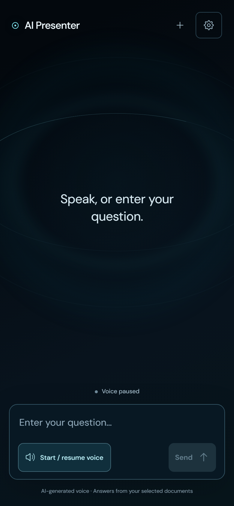

# AI Presenter — User Guide & Operator Manual

Welcome to **AI Presenter**! This guide covers everything needed to use and operate the AI Presenter touchscreen kiosk and autonomous slide presentation system.

---

## 1. Visual Tour of the Application

All screenshots below were captured directly from the live application using Playwright browser automation.

### 1.1 Conversational Kiosk Interface
The primary screen is conversational and distraction-free. The ambient sci-fi aura in the background reflects the live state (listening, thinking, speaking) while questions and grounded AI answers occupy the stage.

---

### 1.2 Document & Presentation Management Drawer
Tap the gear icon in the top right to open the **Slides, documents & voice** drawer. From here, operators upload reference files and slide decks.

---

### 1.3 Question Breaks & Voice Preferences
Scroll down within the settings drawer to configure audience question pauses, speech window duration, AI voice model (Coral, Alloy, Sage), and playback speed.

---

### 1.4 Slide Presentation Mode
When presenting, slide artwork fills the screen with clean typography, live captions synchronized to synthesized speech, and playback controls.

---

### 1.5 Verbatim Script Editor
Tap the document icon (`View / edit script`) to review or edit the narration for any slide. Once saved, the AI reads your edited text verbatim without LLM alterations.

---

### 1.6 Interactive Floor Question Overlay
Audience members can ask questions at any time. Tapping **Ask a question** opens an unobtrusive floor Q&A overlay supporting both voice and keyboard input.

---

### 1.7 Mobile & Tablet Responsiveness
AI Presenter adapts seamlessly to mobile screens and vertical tablet kiosks with 48px touch targets and full gesture support.

---

## 2. Visitor Guide (How to Use the Kiosk)

### 2.1 Hands-Free Voice Interaction
1. Tap **Start / resume voice** at the bottom of the screen.
2. Grant browser microphone permission when prompted.
3. Speak your question naturally.
4. When you stop speaking for ~1.2 seconds, the system automatically detects silence and submits your question.
5. The AI Presenter searches the selected documents and speaks the answer aloud.
6. As the AI speaks, the current sentence highlights in real time. Once playback finishes, the kiosk automatically resumes listening for your next question!
7. Tap **Pause voice** at any time to release the microphone and pause playback.

### 2.2 Typing Questions
If you prefer not to speak, type your question directly into the text box and press Enter or tap the send arrow (`↑`).

### 2.3 Inspecting Supporting Evidence (Citations)
Every factual claim made by the AI is grounded in the documents. 
- Tap **View supporting passages** under any assistant message.
- Inspect the exact quotes and source file names retrieved for that answer.
- If a question cannot be answered using the uploaded documents, the AI Presenter politely refuses to speculate.

### 2.4 Resetting for the Next Visitor
Tap **New conversation** in the top bar when you are finished. This clears your chat messages while keeping the shared document library intact.

---

## 3. Operator & Presenter Guide

### 3.1 Uploading Reference Documents
1. Open settings (gear icon).
2. Under **Document library**, tap **Upload document**.
3. Select any PDF, DOCX, TXT, or Markdown file (up to 30 MB).
4. Wait a few moments for indexing to report **Ready**.
5. Check the box next to documents you want the AI to use as knowledge sources.

### 3.2 Uploading & Preparing Slide Decks
1. In the settings drawer, scroll to **Slide presentations**.
2. Tap **Upload slide deck** and choose a PowerPoint (`.pptx`) or PDF file (up to 40 slides, 30 MB).
3. The system converts each slide into high-definition art and extracts slide text.
4. For PowerPoint files containing animations, the server automatically exports per-slide MP4 video clips.

### 3.3 Presenting Slides
1. Under **Slide presentations**, tap **Open presentation**.
2. Choose your presentation language: **English** or **中文**.
3. The presenter will prepare the slide narration scripts upfront.
4. Tap **Start / resume** or press **Fullscreen** to enter focused presentation mode.
5. Use the arrow buttons (`<` and `>`) to navigate between slides manually, or let the presentation advance automatically.

### 3.4 Customizing Narration Scripts
1. On the presentation screen or in settings, tap **View / edit script**.
2. Select the slide page you wish to inspect.
3. Review the generated text or type your own custom script.
4. Tap **Save script**. The AI presenter will now read your exact text verbatim during future presentations.

### 3.5 Configuring Audience Question Breaks
1. Open settings and locate **Ask questions after these slides**.
2. Use presets:
   - **None**: Delivers continuous presentation without pausing for questions.
   - **Last slide**: Pauses for Q&A only after the final slide concludes.
   - **All slides**: Pauses for floor questions after every individual slide.
   - Or manually check individual slide checkboxes.
3. Adjust the **Question window length** (5, 8, 15, or 30 seconds).

---

## 4. Hardware & Deployment Recommendations

- **Display**: 1080p (1920x1080) or 4K touchscreen monitor.
- **Audio Input**: Directional boundary microphone or noise-canceling USB array placed facing the visitor.
- **Audio Output**: Dedicated external speakers or soundbar positioned away from the microphone to eliminate acoustic feedback.
- **Operating Environment**: Secure Chromium-based browser (Edge or Chrome) running in Kiosk Mode (`--kiosk http://127.0.0.1:3250`).
